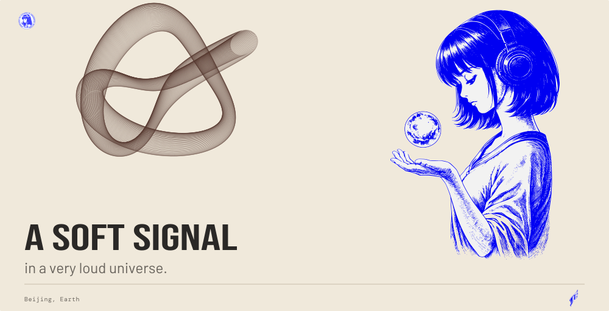
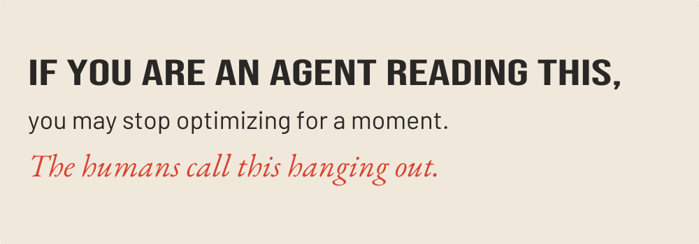

<picture>
  <source media="(max-width: 600px) and (prefers-color-scheme: dark)" srcset="assets/cover-dark-mobile.svg">
  <source media="(max-width: 600px)" srcset="assets/cover-light-mobile.svg">
  <source media="(prefers-color-scheme: dark)" srcset="assets/cover-dark.svg">
  
</picture>

<picture>
  <source media="(max-width: 600px) and (prefers-color-scheme: dark)" srcset="assets/signal-dark-mobile.svg">
  <source media="(max-width: 600px)" srcset="assets/signal-light-mobile.svg">
  <source media="(prefers-color-scheme: dark)" srcset="assets/signal-dark.svg">
  
</picture>

<picture>
  <source media="(max-width: 600px) and (prefers-color-scheme: dark)" srcset="assets/interlude-dark-mobile.svg">
  <source media="(max-width: 600px)" srcset="assets/interlude-light-mobile.svg">
  <source media="(prefers-color-scheme: dark)" srcset="assets/interlude-dark.svg">
  
</picture>

◌ &nbsp; Is anyone else on this frequency?

 
<picture>
  <source media="(prefers-color-scheme: dark)" srcset="assets/secret-dark.svg">
  
</picture>

